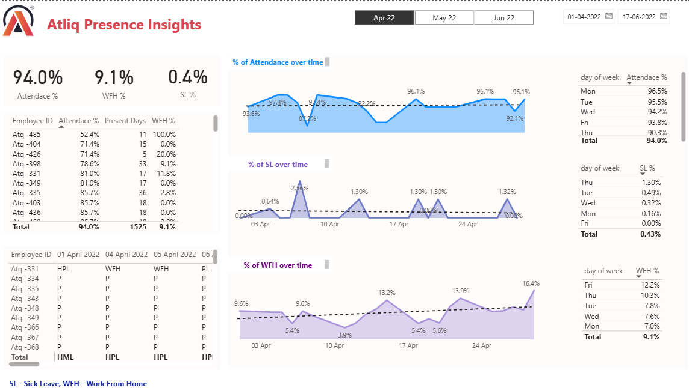
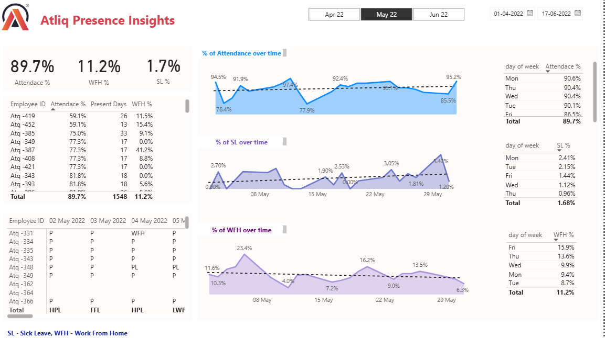
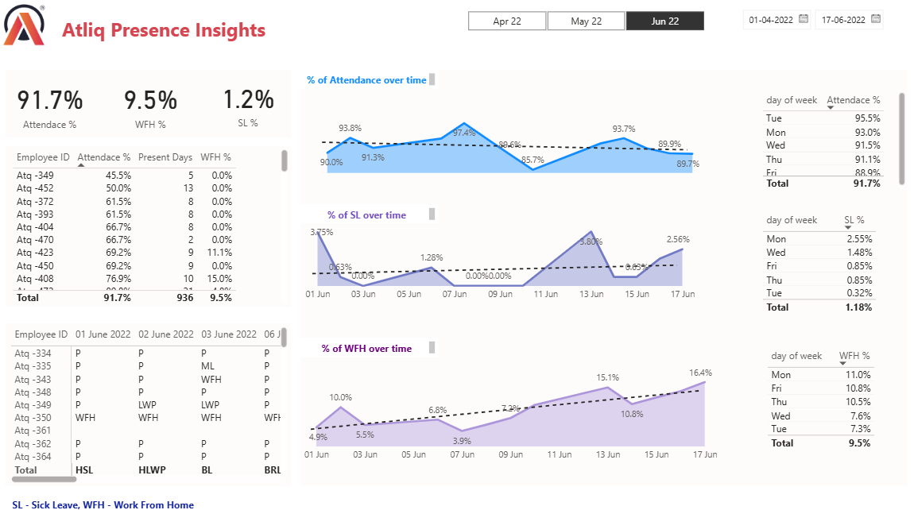

# Revenue Insights in the Hospitality Domain

A Power BI dashboard project focused on analyzing hotel revenue, occupancy, booking performance, and other key hospitality metrics.

## Dashboard Screenshots

### April 2022

### May 2022

### June 2022

## Tools & Technologies

- Microsoft Power BI
- Power Query
- DAX (Data Analysis Expressions)
- Data Modeling
- Data Visualization

## Dataset

The project uses five CSV datasets:

- `dim_date.csv` — Date and week information
- `dim_hotels.csv` — Hotel properties, categories, and cities
- `dim_rooms.csv` — Room categories and room classes
- `fact_aggregated_bookings.csv` — Successful bookings and room capacity
- `fact_bookings.csv` — Booking details, revenue, ratings, and booking status

## Key Metrics & Analysis

- Revenue
- Occupancy Percentage
- Average Daily Rate (ADR)
- Revenue Per Available Room (RevPAR)
- Realisation Percentage
- Booking Platform Performance
- Cancellation Analysis
- Week-on-Week (WoW) Trends

## Project Purpose

The goal of this project is to transform hospitality booking data into actionable insights through interactive dashboards and business performance metrics.
